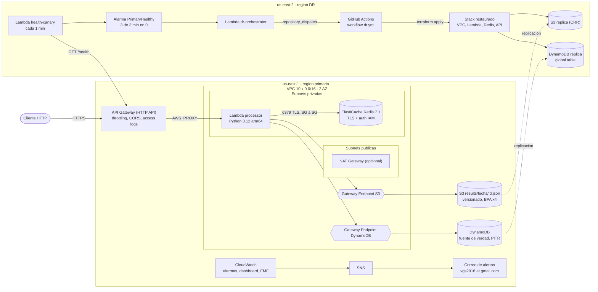

# Sundevs SRE — Servicio de procesamiento serverless en AWS

Infraestructura 100% como código (**Terraform**) para un servicio HTTP que procesa solicitudes con **API Gateway → Lambda (VPC) → ElastiCache Redis → S3**. Se le agregaron **DynamoDB** como registro durable, **DR multi-región** de bajo costo (backup & restore automatizado), **observabilidad con alertas por correo** y un **pipeline de GitHub Actions con promoción por ramas** que se autentica en AWS por **OIDC**, sin llaves estáticas.

---

## 1. Arquitectura



> **Diagrama AWS con iconos oficiales:** [docs/architecture.drawio](docs/architecture.drawio). Ábrelo en [diagrams.net](https://app.diagrams.net/#Uhttps%3A%2F%2Fraw.githubusercontent.com%2Fguayara504%2Fsundevs-sre-test%2Fmain%2Fdocs%2Farchitecture.drawio) o con la extensión *Draw.io Integration* de VS Code.

### Flujo de datos (read-through cache)

```
POST /process {"data": "..."}
  key = sha256(JSON canónico)                       ← mismo JSON = misma key (sin importar el orden)
  Redis GET key ──HIT──▶ 200 + X-Cache: HIT
        │ MISS
        ▼
  DynamoDB GetItem(id) ──existe──▶ re-hidrata Redis (TTL 60s) ──▶ 200 + X-Cache: MISS (X-Result-Source: dynamodb)
        │ no existe
        ▼
  procesar (sha256, reversed, uppercase, conteos)
  S3 PutObject results/<YYYY-MM-DD>/<id>.json      ← vía VPC Gateway Endpoint (forzado por la política)
  DynamoDB PutItem (condicional, idempotente)
  Redis SET key EX 60                               ← TTL explícito siempre
  ──▶ 200 + X-Cache: MISS (X-Result-Source: processed)
```

- Cualquier excepción no controlada → **HTTP 500** con mensaje descriptivo, `requestId` y traza en CloudWatch (más la métrica `ProcessingErrors`).
- Una entrada inválida → **HTTP 400** (`BadRequest`). No es un error del servicio, así que no dispara la alarma de 5xx.
- Si **Redis falla o está apagado**, el servicio **no se cae**: registra `CacheErrors` y responde desde DynamoDB (modo degradado).

---

## 2. Estructura del repositorio

```
bootstrap/                 # Una sola vez, local: estado remoto, roles OIDC, boundary, budget
  modules/state-bucket     # Bucket de estado (versionado, TLS-only, lock nativo)
  modules/github-role      # Rol IAM asumible por GitHub Actions vía OIDC
infra/                     # Stack de la aplicación (un root module, N ambientes)
  envs/{dev,prod,dr}.tfvars / .backend.hcl
  modules/network          # VPC, subnets, IGW, NAT, gateway endpoints, SGs, flow logs
  modules/cache            # ElastiCache Redis + RBAC con autenticación IAM
  modules/data             # S3 + DynamoDB (crea en primary / referencia en dr) + CRR
  modules/dr-storage       # Bucket destino de la réplica en us-east-2
  modules/service          # Lambda + IAM + API Gateway HTTP API
  modules/observability    # SNS → correo, alarmas, dashboard
  modules/dr-automation    # Canary + alarma + orquestador de failover (us-east-2)
src/processor              # Lambda principal (app, cache, store, metrics)
src/health_canary          # Sondeo de salud de la región primaria
src/dr_orchestrator        # Dispara la restauración en DR
tests/                     # Pruebas unitarias (pytest, sin AWS)
scripts/                   # build_lambda.py, smoke_test.sh, setup_github.sh
governance/                # Guardrails tipo SCP implementados con IAM (cuenta sin Organizations)
.github/workflows          # ci, deploy, dr, drift (+ reutilizables _quality, _build)
evidence/                  # Evidencia MISS/HIT y S3
docs/dr-runbook.md         # Procedimiento de DR y failback
```

---

## 3. Prerrequisitos

| Herramienta | Versión usada | Para qué |
|---|---|---|
| Terraform | ≥ 1.10 (probado con 1.13.5) | IaC; usa el lock nativo de S3 (`use_lockfile`) |
| AWS provider | `~> 6.0` | fijado en `.terraform.lock.hcl` |
| AWS CLI | v2 | perfil `sundevs` (solo para bootstrap y despliegue local) |
| Python | 3.12 (3.11+ en local) | build y pruebas de las Lambdas |
| gh CLI | 2.x | opcional: `scripts/setup_github.sh` |

**Permisos AWS:**
- **Bootstrap:** credenciales de administrador (perfil `sundevs`), una sola vez.
- **Pipelines:** ninguno almacenado. GitHub obtiene credenciales temporales vía OIDC asumiendo:

| Rol | Lo puede asumir (claim `sub`) | Permisos |
|---|---|---|
| `sundevs-sre-gha-plan` | `pull_request`, `ref:refs/heads/develop`, `ref:refs/heads/main` | `ReadOnlyAccess` − lectura de datos de negocio + lock del estado |
| `sundevs-sre-gha-dev` | `environment:dev` | recursos `sundevs-sre-dev-*`, estado `sundevs-sre/dev/` |
| `sundevs-sre-gha-prod` | `environment:production` | recursos `sundevs-sre-prod-*`, estado `sundevs-sre/prod/` |
| `sundevs-sre-gha-dr` | `environment:dr` | recursos `sundevs-sre-prod-*`, estado DR en us-east-2 |

Todos llevan `Deny` fuera de `us-east-1`/`us-east-2` y solo pueden crear roles **con** el permissions boundary `sundevs-sre-workload-boundary`.

---

## 4. Despliegue desde cero

### 4.1 Bootstrap (una vez)

```bash
cd bootstrap
# 1er apply con estado local (el bucket de estado aún no existe)
printf 'terraform {\n  backend "local" {}\n}\n' > backend_override.tf
terraform init && AWS_PROFILE=sundevs terraform apply
# migrar el estado al bucket recién creado
rm backend_override.tf
AWS_PROFILE=sundevs terraform init -migrate-state -backend-config=backend.hcl
```

> El OIDC provider `token.actions.githubusercontent.com` ya existía en la cuenta, así que se referencia con un data source y no se toca.

### 4.2 Repositorio GitHub

```bash
git remote add origin git@github.com:guayara504/sundevs-sre-test.git
git push -u origin main develop
./scripts/setup_github.sh guayara504/sundevs-sre-test 624991055549
```

El script crea la variable `AWS_ACCOUNT_ID`, los environments `dev` (solo `develop`), `production` (solo `main` + aprobación) y `dr` (solo `main`), y protege las ramas `develop` y `main`.

### 4.3 Aplicación: un solo comando por ambiente

```bash
python scripts/build_lambda.py                      # build/processor.zip, health_canary.zip, dr_orchestrator.zip
cd infra
terraform init -backend-config=envs/dev.backend.hcl
AWS_PROFILE=sundevs terraform apply -var-file=envs/dev.tfvars
```

En operación normal **nadie corre `apply` a mano**: lo hace el pipeline (sección 7).

---

## 5. Verificación end-to-end

```bash
API=$(terraform -chdir=infra output -raw api_endpoint)

curl -s -D - -X POST "$API/process" -H 'Content-Type: application/json' -d '{"data":"hola sundevs"}'
# HTTP/2 200 ... x-cache: MISS  x-result-source: processed

curl -s -D - -X POST "$API/process" -H 'Content-Type: application/json' -d '{"data":"hola sundevs"}'
# HTTP/2 200 ... x-cache: HIT   x-result-source: redis

aws s3 ls "s3://$(terraform -chdir=infra output -raw results_bucket)/results/" --recursive

# Casos de error
curl -s -X POST "$API/process" -d 'no-json'          # 400 BadRequest
curl -s "$API/health"                                 # 200 {"status":"ok"}

# Todo junto (lo mismo que ejecuta el pipeline):
./scripts/smoke_test.sh "$API" true
```

La evidencia real está en [evidence/](evidence/).

---

## 6. Decisiones de diseño

| Decisión | Elección | Por qué |
|---|---|---|
| Tipo de API | **HTTP API** | Cerca de 70% más barata y con menos latencia que REST API. Trae CORS nativo, payload v2 y throttling por stage, que es todo lo que pide el requerimiento. REST API solo haría falta para WAF directo, API keys/usage plans o validación de request; si se necesita WAF, se pone CloudFront + WAF delante. |
| Cache | **ElastiCache Redis 7.1 `cache.t3.micro`** | El nodo más económico con TLS, RBAC y autenticación IAM. En prod son 2 nodos Multi-AZ con failover automático; en dev, 1. |
| Autenticación Redis | **IAM (RBAC), sin password** | La Lambda firma un token SigV4 con su rol, localmente y sin red. No hay secreto que guardar, rotar ni filtrar. El usuario `default` está deshabilitado y el usuario de la app solo puede `GET/SET/PING/TTL/EXISTS`. |
| TTL | `SET key value EX 60` siempre | La clase `Cache` no tiene forma de escribir sin TTL (`ttl<=0` lanza excepción y hay un test que lo cubre). |
| Base de datos | **DynamoDB on-demand** como fuente de verdad, Redis solo como cache de lectura | Redis es volátil (TTL de 60s, sin snapshots). DynamoDB guarda el resultado de forma durable: cuando expira la cache se responde sin reprocesar ni reescribir S3. Las escrituras condicionales (`attribute_not_exists`) hacen el procesamiento idempotente frente a requests concurrentes. |
| Salida a S3 | **VPC Gateway Endpoint**, *forzado* | (1) La ruta del endpoint está en la tabla privada. (2) La política del bucket niega a la Lambda cualquier acceso que no venga de `aws:SourceVpce`. (3) La política IAM de la Lambda tiene la misma condición. (4) La política del endpoint solo permite este bucket. (5) El SG de la Lambda solo tiene egress 443 al *prefix list* de S3. |
| DynamoDB | Gateway Endpoint también | Gratis, y la Lambda no necesita internet para ninguna dependencia. |
| NAT Gateway | Presente pero **apagable** (`enable_nat_gateway`) | Lo exige el enunciado, pero con los gateway endpoints la Lambda no lo usa. Apagarlo ahorra unos 33 USD/mes por ambiente sin afectar la función. En prod crítico se usaría uno por AZ. |
| Security Groups | Referencias SG→SG + prefix lists | Lambda → Redis solo 6379; Redis solo acepta desde el SG de Lambda y no tiene egress. El SG por defecto de la VPC queda sin reglas. |
| Bucket S3 | BPA x4, versionado, SSE, TLS obligatorio, `BucketOwnerEnforced`, lifecycle | Plano de datos restringido al rol de la Lambda (y al de replicación). Los resultados pasan a Standard-IA a los 30 días. |
| Lambda | Python 3.12, **arm64 (Graviton)**, logs JSON, X-Ray | Graviton cuesta cerca de 20% menos. Las métricas de negocio van por **EMF** (CacheHit/Miss/Errors) y no requieren llamadas de red. |
| Secretos | Ninguno en el código ni en tfvars | Redis usa IAM. El token de GitHub del DR vive en Secrets Manager y se carga fuera de Terraform, así que no queda en el estado. |
| Estado Terraform | S3 por región + `use_lockfile` | Ya no hace falta tabla DynamoDB de locks (TF ≥ 1.10). El estado del DR vive en us-east-2 para no depender de la región caída. |

---

## 7. CI/CD con GitHub Actions

### Ramas y ambientes

```
feature/*  ──PR──▶  develop  ──push──▶  deploy → environment "dev"         (automático)
                      │
                      └──PR──▶  main  ──push──▶  deploy → environment "production" (aprobación manual)
hotfix/*   ──PR──▶  main  (luego back-merge a develop)
```

| Workflow | Disparador | Qué hace |
|---|---|---|
| `ci.yml` | PR a `develop`/`main` | Regla de promoción (a `main` solo se entra desde `develop` o `hotfix/*`) → **quality** → **build** → `terraform plan` del ambiente destino, comentado en el PR |
| `deploy.yml` | push a `develop`/`main` | quality → build (artefacto único) → **plan** con rol de solo lectura (plan guardado) → **apply del mismo plan** con el rol del ambiente, detrás del *environment* (aprobación en prod) → **smoke test** MISS/HIT |
| `dr.yml` | `repository_dispatch: dr-failover` (orquestador) o manual | Restaura prod en us-east-2, corre el smoke test y notifica la URL por SNS. También hace `teardown` tras el failback. |
| `drift.yml` | Lunes a viernes, 06:00 (Bogotá) | `plan -detailed-exitcode` en dev y prod; si hay cambios fuera de IaC abre un issue |
| `_quality.yml` | Reutilizable | ruff (lint + reglas de seguridad), pytest, `terraform fmt/validate`, tflint, **Checkov**, **gitleaks** |

### Buenas prácticas aplicadas

- **OIDC, sin llaves AWS en GitHub.** El claim `sub` va anclado a repo + environment, y los roles de despliegue solo confían en su *environment*.
- **Separación plan/apply.** El plan corre con un rol de solo lectura y el apply ejecuta exactamente el plan revisado (`tfplan` como artefacto).
- **Build una sola vez.** El zip es determinista (mismo código, mismo hash), así que no hay redeploys fantasma.
- **`concurrency` por ambiente.** Nunca hay dos applies a la vez y un apply en curso nunca se cancela.
- **Permisos mínimos del `GITHUB_TOKEN`**, declarados por job (`id-token: write` solo donde se asume un rol).
- **`-lockfile=readonly`.** Los providers quedan fijados con hashes para Linux, Windows y macOS.
- **Gates de seguridad bloqueantes.** Checkov tiene excepciones justificadas en [.checkov.yaml](.checkov.yaml) y gitleaks escanea secretos.
- **Dependabot** para Actions, pip y Terraform; **CODEOWNERS** y plantilla de PR.

---

## 8. Observabilidad

- **SNS → `vgs2016@gmail.com`**: hay que **confirmar la suscripción** desde el correo que envía AWS.
- **Alarmas** (con notificación de ALARM y de OK): errores, throttles y duración p95 de Lambda; 5xx y latencia p95 de la API; `CacheErrors` (modo degradado); throttling de DynamoDB; CPU y memoria de Redis por nodo; errores de puertos del NAT.
- **Dashboard** `sundevs-sre-<env>-use1-overview`: tráfico, latencia, HIT vs MISS y salud de la Lambda.
- **Logs**: JSON estructurado de la Lambda, access logs de la API, slow-log de Redis y VPC Flow Logs (REJECT), todos con retención por ambiente.
- **Presupuesto**: AWS Budgets de 30 USD/mes filtrado por la etiqueta `Project` (alerta al 80% real y al 100% pronosticado). La etiqueta `Project` debe activarse como *cost allocation tag* en Billing.

---

## 9. DR multi-región: backup & restore automatizado

| | Valor | Cómo |
|---|---|---|
| Estrategia | **Backup & Restore** (la más económica) | El cómputo se recrea con IaC bajo demanda |
| RPO | segundos a minutos | DynamoDB global table (réplica asíncrona) + S3 CRR, ambos con PITR/versionado |
| RTO | unos 15 a 25 min | 3 min de detección + `terraform apply` (lo que más tarda es ElastiCache) |
| Costo en reposo | menos de 2 USD/mes | Canary (capa gratuita), almacenamiento replicado, un secreto y alarmas. Sin NAT, Redis ni VPC en DR. |

Detalle y procedimiento de failback en [docs/dr-runbook.md](docs/dr-runbook.md).

---

## 10. Costos y el interruptor de ahorro

| Recurso | Costo aproximado/mes | Interruptor |
|---|---|---|
| NAT Gateway + EIP | unos 33 USD por ambiente | `enable_nat_gateway = false` |
| ElastiCache t3.micro | unos 12 USD por nodo | `enable_redis = false` (la Lambda sigue respondiendo desde DynamoDB) |
| Lambda, API GW, DynamoDB on-demand, S3 | céntimos con tráfico de prueba | pago por uso |

Después de validar el servicio se apagaron NAT y Redis en **dev** y en **prod** (`envs/dev.tfvars`, `envs/prod.tfvars`). Ambos ambientes siguen respondiendo en modo degradado, desde DynamoDB vía gateway endpoints. Para reactivar la cache basta con poner `enable_redis = true` (y `enable_nat_gateway` si se necesita salida a internet) y desplegar por el pipeline. El DR en us-east-2 queda **mapeado**: datos replicados y automatización lista, sin cómputo encendido.

---

## 11. Mapeo con AWS Well-Architected

| Pilar | Implementación |
|---|---|
| **Excelencia operacional** | Todo IaC, pipelines con plan/apply, drift diario, runbook de DR, logs estructurados, dashboard |
| **Seguridad** | OIDC, mínimo privilegio, permissions boundary, guardrails de región, subnets privadas, SG→SG, VPC endpoints forzados, Redis TLS + IAM, S3 privado con TLS obligatorio, Checkov y gitleaks, guardrails tipo SCP con IAM |
| **Confiabilidad** | 2 AZ, Redis Multi-AZ en prod, degradación controlada sin Redis, idempotencia, PITR, réplica multi-región, failover automatizado |
| **Eficiencia de rendimiento** | Cache read-through, HTTP API, Graviton, conexiones Redis reutilizadas entre invocaciones |
| **Optimización de costos** | Serverless pay-per-use, interruptores NAT/Redis, gateway endpoints gratis, DR backup & restore, presupuesto con alertas, lifecycle S3 |
| **Sostenibilidad** | arm64, sin recursos ociosos en DR, lifecycle a IA |

---

## 12. Limitaciones conocidas y siguientes pasos

1. **Una sola cuenta independiente.** Los guardrails tipo SCP (regiones, boundary, protección de roles del pipeline) se implementan con IAM y aplican a los roles del pipeline y de la carga de trabajo, no a los administradores de la cuenta (ver [governance/](governance/README.md)).
2. **Cuota de concurrencia de Lambda = 10** (cuenta nueva). Conviene pedir el aumento a 1000 en Service Quotas antes de producción real.
3. **Failover de DNS.** Las URLs de API Gateway cambian por región. Con un dominio propio se agregaría Route 53 con registro *failover* y un custom domain en ambas regiones.
4. **KMS CMK.** Hoy se usan llaves administradas por AWS. Para cumplimiento estricto se cambiaría a CMK (S3, DynamoDB, SNS, logs).
5. **Autenticación de la API.** Es pública por requerimiento. Para consumidores reales se agregaría un JWT authorizer (Cognito) y WAF vía CloudFront.
